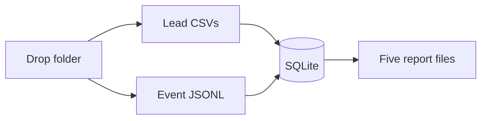
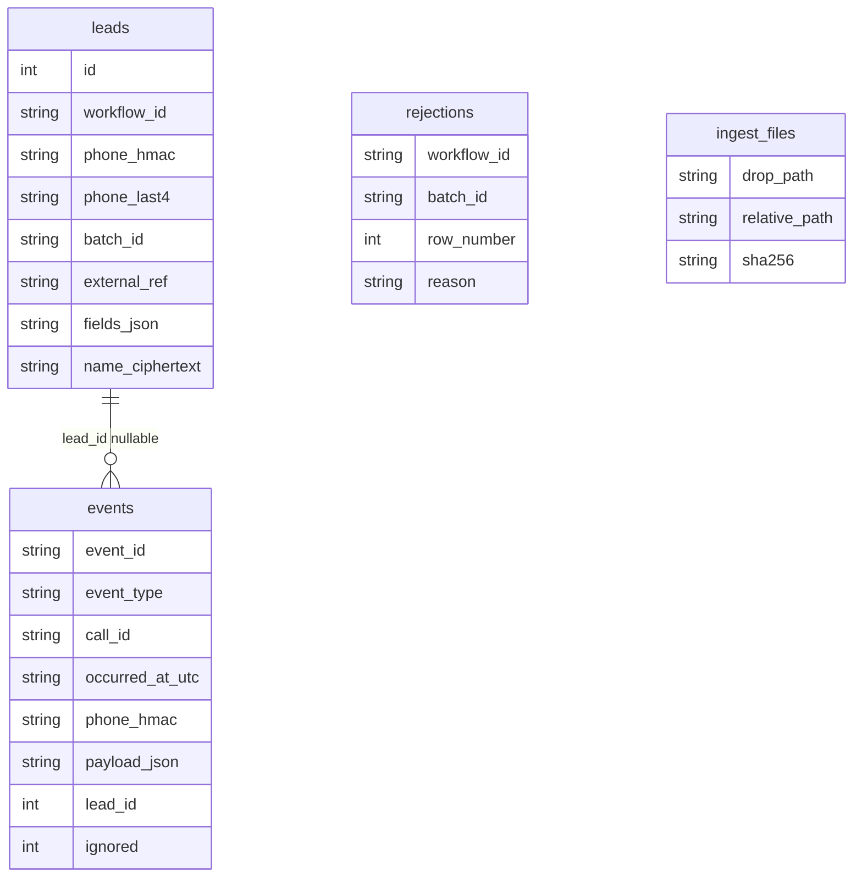

# Submission

## Candidate
- **Name:** YOUR NAME
- **Assignment chosen:** A (Data)
- **Time spent (honest estimate):** replace with your own hours

## How to run

From the repository root. On Windows PowerShell, activate the virtualenv with `.venv\Scripts\Activate.ps1` instead of `source`.

```bash
python -m venv .venv
source .venv/bin/activate
pip install -r requirements.txt
python assignment-a-data/tools/generate_data.py --seed 42 --scale small --out data
python -m solution ingest data/drop_1
python -m solution ingest data/drop_2
python -m solution report --out reports
pytest
```

The database defaults to `au_assignment.sqlite` in the working directory. `--db` and `--schemas` work either before the subcommand or after it. Generated `data/`, `reports/`, and `*.sqlite*` are gitignored.

## Design

`ingest` is the only writer. `report` only reads SQLite and writes the five files. The workflow JSON files and `dispositions.csv` are rulebooks loaded into memory. They are not the system of record.



Inside one drop the order is fixed: lead CSVs by filename, then event files by filename, then a link pass, all in one transaction. Lead merge order follows that. An event that arrives before its lead stays unlinked until a later drop inserts the lead; the link pass then attaches it. Reports are recomputed from the whole database, so they always describe everything ingested so far.



- `leads` is unique on `(workflow_id, phone_hmac)`. `batch_id` is the first file stem and never changes. Non-PII columns live in `fields_json` because the two workflows have different fields. `external_ref` is the schema field marked `"reference": true`.
- `events` is append-only on payload. `event_id` is the primary key. The only update is filling `lead_id` when a later drop identifies the lead, and setting `ignored` when that now-linked disposition code is not in the catalogue. A `disposition.set` row is never edited into an override.
- `ingest_files` stores the checksum of each file. A second ingest of the same file does no parsing and does not move counters.
- `quality` stores counters that only increase when a new line is processed. Orphan and unknown-disposition counts are queries, so a late lead reduces the orphan count.
- `rejections` has workflow, batch, row number, and reason. No name and no phone.

A call exists only when a linked, non-ignored `call.initiated` exists for that `call_id`. Its date is the IST date of that event. It is connected when a linked `call.connected` shares the call. The effective disposition is the latest `disposition.override` by time. If there is no override, it is the latest `disposition.set`. Equal timestamps break toward the later ingested row. The lead bucket is the first match of: no calls, any terminal disposition, every call has `call.telephony_failed`, otherwise still dialing.

## Decisions & assumptions

| Decision | Why | Alternative considered |
|---|---|---|
| SQLite, reports scanned from the full database | Correct and easy to re-run. The small seed finishes in seconds. | Incremental aggregate tables. Deferred; a bug there would be harder to see. |
| Phone stored as HMAC-SHA256 plus last 4 digits | Events still join to leads, and the report mask needs the last 4. A plain hash of an Indian mobile can be reversed by enumeration. | Encrypting the phone and decrypting it on every join. |
| `customer_name` encrypted with Fernet | No report prints it, and the spec forbids plaintext PII. | Dropping the name entirely. Encryption keeps it recoverable for a later report. |
| Unknown disposition codes are stored and marked `ignored` | The `event_id` must not be insertable again, and the code must not become an outcome. | Deleting the row. A re-ingest would then count it twice unless the id was saved anyway. |
| An unlinked bad disposition counts as an orphan, not as unknown | The spec checks orphan before unknown. After the lead arrives, the link pass reclassifies it. | Counting both. |
| `rejections_by_reason` contains only reasons with a count above zero, keys sorted | The zeros in the README are a shape example. Real runs have several different `missing_required:<field>` keys. | Emitting a fixed set of keys with zeros. |
| `lead_rows_total` counts non-blank data rows | The spec says blank rows are skipped and not counted. | Counting physical lines, which would include blanks and the header. |
| A whitespace-only event line is malformed and counted | It is a non-empty line and it is not JSON. A fully empty line is ignored and not counted. | Skipping whitespace lines silently. |
| Disposition codes are compared exactly, case-sensitive | The catalogue is lowercase. The generator's bad codes (`RENEWD`, `call_back`) are different strings, not case variants. | Case-insensitive match, which would hide those bad codes. |
| Invalid optional values become null, then defaults fill what is still null | Both sentences are in the spec. An invalid language therefore warns and the lead still gets `en` if nothing valid arrived. | Leaving the field null and skipping the default. |
| After header normalisation, trim again | A leading underscore run would otherwise leave a space (`__phone` → ` phone`) and the column would be ignored. | Following the trim-then-replace order with no final trim. |
| Tied `occurred_at` uses the later `ingest_seq` | The result is stable across re-runs. | Leaving the tie undefined. |
| A call with more than one `call.initiated` uses the earliest as its start | The generator emits one. The rule needs a deterministic choice. | Counting two calls for one `call_id`. |
| Same phone in two workflows is two leads | Identity is `(workflow_id, canonical phone)`. | A global phone key, which would merge a renewal lead with a feedback lead. |
| File checksum changed since ingest raises, and does not reprocess | Reprocessing would double-count. The assignment's files do not change. | Silently skipping, which hides a real change. |

The HMAC key and the Fernet key are constants in `solution/pii.py`. The data is synthetic. Reports do not depend on decrypting anything.

## Failure modes considered

- Bad lead rows are rejected with one reason, in schema order, and are not leads. Blank rows are ignored. Unknown CSV columns are ignored. Renamed headers match aliases.
- Re-running `ingest` on a drop already loaded changes nothing. Checked on seed 42: the second run read 0 files and the five report files were byte-identical.
- Duplicate `event_id`s, including copies that arrive in a later drop, are counted and dropped. Malformed lines are counted and dropped.
- Events for a phone that has no lead yet are stored unlinked and stay out of every report. When the lead arrives, the link pass attaches them. An override with no phone attaches through `call_id` after some other event of that call has a lead. If the override is earlier in the file than `call.initiated`, the end-of-drop link pass still attaches it.
- A disposition code that is not in the catalogue does not become the effective outcome, so a valid `disposition.set` is kept when the override code is unknown.
- Naive timestamps are read as IST. `Z` and numeric offsets are honoured. Report dates and `last_call_at` are IST.
- One transaction per drop. A crash mid-file rolls back that drop; the next run loads it again. A checksum mismatch on a file already loaded refuses to continue rather than double-counting.
- Not handled: two dispatcher processes writing one database. This program is a single process. The large-scale timing target and SQL-only aggregation are not done. A changed input file is rejected rather than migrated.

## Testing

`pytest` covers the rules that move the numbers:

- Phone formats, including a leading `0`, a `91` prefix, spaces, and dashes. Too-short, bad-prefix, landline, and foreign numbers fail.
- Day-first dates, month names, and impossible days such as 31/02 and 2026-02-29.
- Money prefixes, thousands separators, and half-up rounding.
- Header aliases, including a leading underscore.
- Naive versus `Z` versus `+05:30`, and a UTC evening that falls on the next IST date.
- Rejection order: a missing name wins over a later bad phone. An empty phone is `missing_required:phone`, not `invalid_phone`.
- Invalid optional fields warn and do not reject.
- An override wins even when a `disposition.set` is later. Timestamp ties use ingest order.
- Bucket priority, including a terminal outcome beating an all-failed set of calls.
- A full two-drop fixture: merge, alias headers, late lead, override with no phone placed before `call.initiated`, duplicate event, malformed line, blank spreadsheet row, masked phones, and the five files byte for byte.
- An unknown code stays an orphan until the lead exists, then becomes unknown and does not label the call.
- An unknown override does not replace a valid `renewed`.
- The same phone in both workflows is two leads.
- Re-ingesting the fixture does not change the report bytes.
- The database file does not contain the sample name or the canonical phone.

Not covered by an automated oracle: the grader's hidden seed. Seed 42 was ingested and checked with the invariants below, not against a hidden expected file.

## Results

Seed 42, `--scale small`, both drops, on this Windows laptop. Both ingests plus the report finished in about 12 seconds of wall clock, including process startup. The second ingest read 0 files and the report bytes did not change.

```json
{
  "lead_rows_total": 2057,
  "lead_rows_rejected": 108,
  "rejections_by_reason": {
    "invalid_phone": 42,
    "missing_required:customer_name": 25,
    "missing_required:order_id": 13,
    "missing_required:phone": 14,
    "missing_required:policy_number": 14
  },
  "duplicate_lead_rows_merged": 57,
  "field_warnings": 122,
  "events_total": 8745,
  "malformed_events": 8,
  "duplicate_events_dropped": 237,
  "orphan_events": 462,
  "unknown_disposition_events": 18
}
```

Those 2,057 non-blank rows are the 2,000 generated leads plus 57 duplicate rows. 108 rejected, so 1,892 leads. The six batch rows sum to 1,892, and each batch's four buckets sum to its `total_leads`. Stored events equal `events_total - malformed - duplicates`. No event is both an orphan and an unknown disposition. A spot-checked `renewed` override is `completed` with `ever_success=true`. A spot-checked `payment_link_sent` override stays `in_progress_dialed`. The name from the first motor row is not present in the SQLite file.

`batch_summary.csv` for this seed:

```text
motor_renewal,batch_001,389,106,7,105,171
motor_renewal,batch_002,326,86,5,102,133
motor_renewal,batch_003,236,68,5,60,103
policy_feedback,batch_001,356,93,7,102,154
policy_feedback,batch_002,344,99,9,98,138
policy_feedback,batch_003,241,60,5,59,117
```

## If I had another day

1. Run `--scale large` and record ingest and report time. If report time dominates, aggregate in SQL.
2. Keep per-batch and per-day counters updated during ingest, and explain the trade-off: faster reports, more chances to drift from the ledger.
3. A production note for 100k leads/day: one ingest job per drop, the ledger as the source of truth, a quarantine table for orphans, and a backfill that only re-links rather than re-parsing old files.
